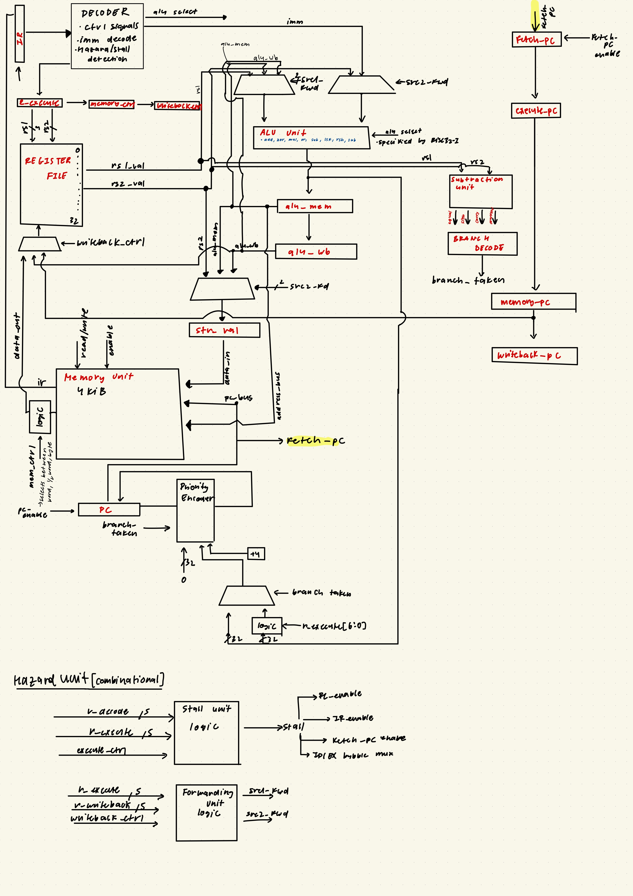
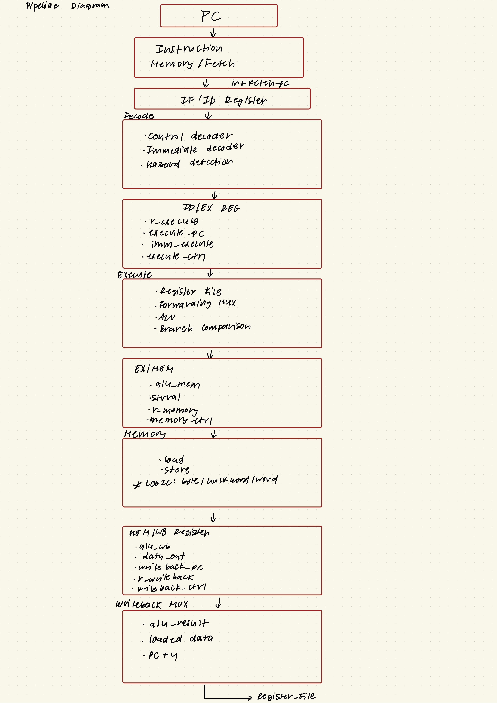

# Context

I started this project before taking computer architecture because I wanted to explore designing a CPU microarchitecture from scratch, without being biased toward standard implementations. Since this processor does not implement exceptions, I chose to update its control state directly in the execute stage rather than waiting until writeback. As a fun side quest, I also integrated a dedicated DSP unit with an FFT. That part of the project taught me a lot about metastability and safely crossing clock domains on an FPGA!


## Key Highlights

- Pipelined RV32I datapath
- Data forwarding and load-use hazard detection
- Conditional branches, `JAL`, and `JALR`
- Byte, halfword, and word loads and stores
- Signed and unsigned comparisons and loads
- Unified dual-port instruction and data memory model
- I2S stereo receiver with left-channel sample capture
- Asynchronous FIFO using Gray-code pointer synchronization
- 256-point radix-2 Stockham FFT
- Q1.15 twiddle factors and 32-bit complex sample storage
- Ping-pong FFT memory banks
- CPU and DSP simulation coverage

## CPU Architecture

### Hand-drawn Datapath




### Pipeline State



### Supported Instruction Classes

The current datapath supports:

- Register ALU: `ADD`, `SUB`, `SLL`, `SLT`, `SLTU`, `XOR`, `SRL`, `SRA`, `OR`, `AND`
- Immediate ALU: `ADDI`, `SLLI`, `SLTI`, `SLTIU`, `XORI`, `SRLI`, `SRAI`, `ORI`, `ANDI`
- Upper immediate: `LUI`, `AUIPC`
- Loads: `LB`, `LH`, `LW`, `LBU`, `LHU`
- Stores: `SB`, `SH`, `SW`
- Branches: `BEQ`, `BNE`, `BLT`, `BGE`, `BLTU`, `BGEU`
- Jumps: `JAL`, `JALR`

System instructions, exceptions, interrupts, and privileged architecture are not currently implemented.

### Hazard Handling

The forwarding unit compares the execute-stage source registers against destination registers in the EX/MEM and MEM/WB stages.

```text
00 = register-file value
10 = forward from EX/MEM using alu_mem
01 = forward from MEM/WB using wb_value
```

EX/MEM forwarding has priority because it contains the newest result. The same `src2_fwd` selection is used for ALU operands and store data.

A dependent instruction stalls for one cycle after a load because the loaded value is not available in `alu_mem`. During a stall:

- The PC holds its value
- The instruction register holds its value
- `fetch_pc` holds its value
- A NOP is inserted into the execute stage

Taken branches and jumps redirect the PC from the execute-stage ALU output and flush younger instructions.

## Audio DSP Architecture
-will update soon..

## Repository Layout


## Running the Simulations

The following examples use Icarus Verilog and should be run from the `Soc` directory.

### CPU Integration Test

```bash
iverilog -g2012 -s testbench -o /tmp/cpu_tb \
  pipeline_cpu/p_cpu.sv \
  pipeline_cpu/pipeline.sv \
  pipeline_cpu/ALU/alu.sv \
  pipeline_cpu/MEMORY/p_memory.sv \
  pipeline_cpu/REGISTERS/p_registers.sv \
  pipeline_cpu/RST/rst.sv \
  pipeline_cpu/testbench_tb.sv

vvp /tmp/cpu_tb
```

### ALU Branch Test

```bash
iverilog -g2012 -s alu_test -o /tmp/alu_tb \
  pipeline_cpu/ALU/alu.sv \
  pipeline_cpu/ALU/alu_tb.sv

vvp /tmp/alu_tb
```

### DSP Integration Test

```bash
iverilog -g2012 -s testbench -o /tmp/dsp_tb \
  DSP_UNIT/i2s_fifo.sv \
  DSP_UNIT/fourier.sv \
  DSP_UNIT/dsp_unit.sv \
  DSP_UNIT/testbench_tb.sv

vvp /tmp/dsp_tb
```

The DSP testbench reports each completed FFT frame and displays the complex value of bin zero.

## Verification Completed

Development-time simulations have covered:

- RV32I register and immediate arithmetic
- Signed and unsigned comparisons
- Logical and arithmetic shifts
- Forwarding from EX/MEM and MEM/WB
- Load-use stalls
- Store-data forwarding
- Byte, halfword, and word memory operations
- Signed and unsigned load extension
- All six RV32I branch conditions
- `JAL` and `JALR` targets and link addresses
- Pipeline flushing
- Consecutive DSP frames
- FFT impulse response across all 256 bins

## Current Limitations and Next Steps


## Tools

- SystemVerilog
- Icarus Verilog
- Python and NumPy for FFT reference modeling
- C++ LUT generation utilities
